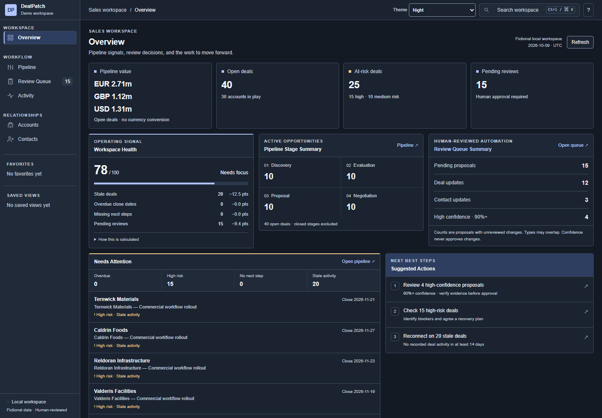
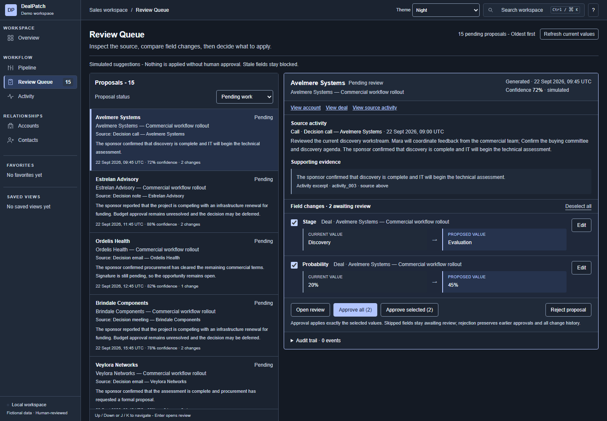
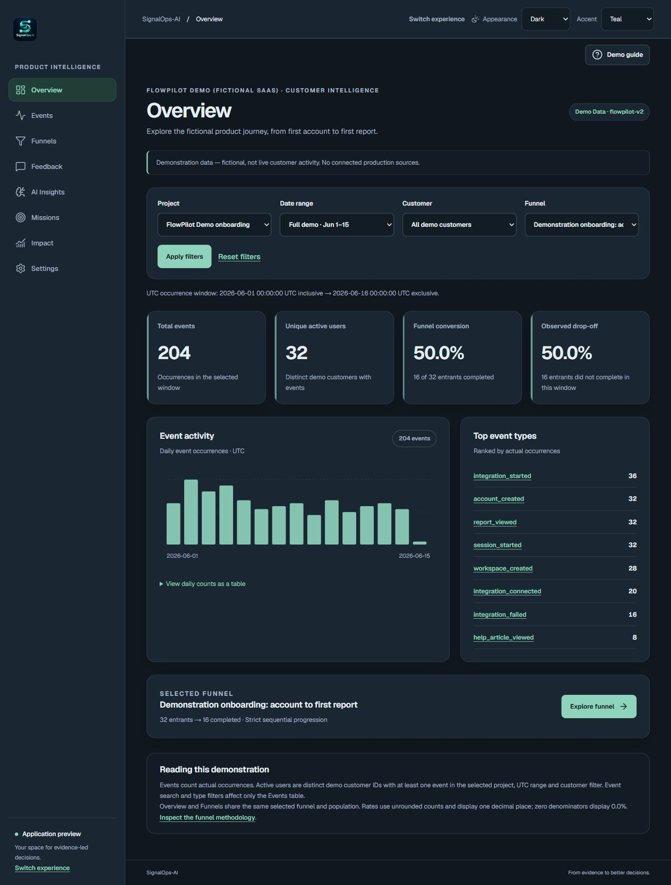
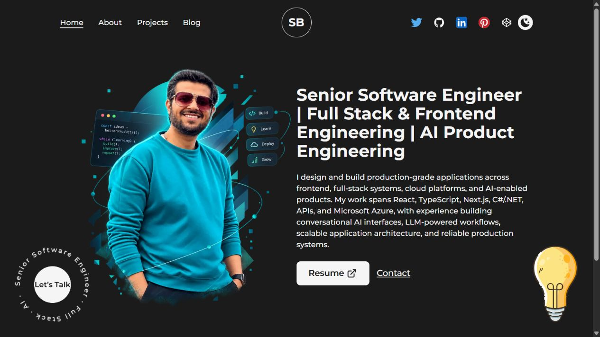
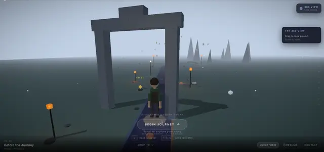

<picture>
  <source media="(prefers-reduced-motion: reduce) and (max-width: 600px)" srcset="assets/hero/terminal-mobile-static.svg">
  <source media="(prefers-reduced-motion: reduce)" srcset="assets/hero/terminal-static.svg">
  <source media="(max-width: 600px)" srcset="assets/hero/terminal-mobile.svg">
  
</picture>

<p align="center">
  <a href="https://www.saurabhbatra.com/">Website</a> &nbsp; / &nbsp;
  <a href="https://www.saurabhbatra.com/projects">Projects</a> &nbsp; / &nbsp;
  <a href="https://3dportfolio-sepia.vercel.app/">3D portfolio</a> &nbsp; / &nbsp;
  <a href="https://www.linkedin.com/in/saurabhbat">LinkedIn</a>
</p>

## 01 / `$ whoami`

**I'm Saurabh, a Frontend-Led Full Stack Engineer.** I build enterprise applications, AI-enabled products, and interactive experiences, with frontend architecture at the center of my work.

My engineering work spans React, TypeScript, Next.js, C#/.NET, APIs, and Azure. I care about making complex workflows clear: data-dense interfaces, explicit state transitions, and AI suggestions that people can inspect before acting on them.

<details>
<summary><strong>$ cat engineering-focus.json</strong></summary>

```json
{
  "frontend": ["React", "TypeScript"],
  "systems": ["Full stack", "Azure"],
  "exploring": ["Python", "AI integration"],
  "interactive": ["3D web", "Unity"],
  "building": ["DealPatch", "SignalOps-AI"]
}
```

[Explore my engineering projects →](https://www.saurabhbatra.com/projects)

</details>

## 02 / `$ ls featured-projects/`

### DealPatch

**Human-reviewed CRM automation.** A local-first B2B sales workspace with data-dense pipeline views, field-level proposal diffs, selective approvals, audit history, and undo.

[](https://dealpatch.vercel.app/)

`Next.js` · `React` · `TypeScript` · `TanStack Query / Table / Virtual` · `Dexie / IndexedDB`

[Explore the demo ↗](https://dealpatch.vercel.app/) &nbsp; · &nbsp; [Browse the repository →](https://github.com/shubhbatra1991/dealpatch)

<details>
<summary><strong>Inside the workflow: evidence → proposal → review → audit</strong></summary>

Activity produces a proposed CRM change through simulated analysis. Reviewers can inspect the evidence, approve selected fields, edit, or reject. Optimistic updates include rollback and stale-change protection.



The demo uses fictional data and browser-local storage. Its AI workflows are simulated; no external AI provider or account is required. The project also uses Tailwind CSS, Zod, and Playwright.

</details>

---

### SignalOps-AI

**From customer signals to product decisions.** A customer and product intelligence demo connecting event analytics, onboarding funnels, and fictional feedback to evidence review, editable Product Missions, and before/after measurement.

[](https://signalops-ai-nine.vercel.app/demo)

`Next.js` · `React` · `TypeScript` · `Tailwind CSS` · `Zod` · `Vitest / Playwright`

[Explore the demo ↗](https://signalops-ai-nine.vercel.app/demo) &nbsp; · &nbsp; [Browse the repository →](https://github.com/shubhbatra1991/signalops-ai)

<details>
<summary><strong>Inside the workflow: signals → evidence → missions → measurement</strong></summary>

Deterministic analytics calculate event counts, ordered funnel progression, and drop-offs. Feedback and behavioural context support evidence review; Product Missions retain their provenance and live in browser-local storage.

Optional AI research supports OpenAI, Groq, Anthropic, and Z.ai in explicitly configured self-hosted mode, with review before each insight request. Provider requests are disabled in the public demo.

This is a demo-first application with fictional data. Production ingestion, authentication, and shared cloud workspaces are not implemented. Completing a mission is kept separate from proving its impact.

</details>

## 03 / `$ open portfolio`

### Personal website

[](https://www.saurabhbatra.com/)

My engineering background, selected projects, and case studies across frontend, full-stack systems, cloud, and AI product engineering.

[Visit the website ↗](https://www.saurabhbatra.com/) &nbsp; · &nbsp; [Explore selected projects →](https://www.saurabhbatra.com/projects)

### Interactive 3D portfolio

[](https://3dportfolio-sepia.vercel.app/)

An immersive, chapter-based journey through my engineering story, with interactive navigation and a 360° explore view. Preview from my public Projects page.

[Enter the 3D experience ↗](https://3dportfolio-sepia.vercel.app/)

## 04 / `$ open game-lab`

### Project Oven · Unity version

A cozy bakery management simulation in development. An exploration of gameplay systems, simulation, and the experience of running a bakery.

`Unity` &nbsp; · &nbsp; **In development**

> **Gameplay preview pending — actual Unity screenshots required.**
> Provide an approved gameplay capture for `assets/games/project-oven-gameplay.png`.
> An optional short gameplay clip can be added as `assets/games/project-oven-gameplay.gif`.

This placeholder will be replaced with real gameplay media when available.

## 05 / `$ cat toolkit`

| Area | Tools & focus |
| :--- | :--- |
| Frontend engineering | React · TypeScript · Next.js · Tailwind CSS · TanStack |
| Backend & APIs | C#/.NET · Node.js · API development |
| Cloud & delivery | Microsoft Azure · GitHub Actions |
| AI integration | Conversational interfaces · LLM workflows · RAG |
| Interactive & games | Three.js · React Three Fiber · Unity |
| Quality | Playwright · Vitest · Zod |

## 06 / `$ git log --graph`

<details>
<summary><strong>Play the contribution snake</strong></summary>

<picture>
  <source media="(prefers-color-scheme: dark)" srcset="https://raw.githubusercontent.com/shubhbatra1991/shubhbatra1991/output/github-contribution-grid-snake-dark.svg">
  <source media="(prefers-color-scheme: light)" srcset="https://raw.githubusercontent.com/shubhbatra1991/shubhbatra1991/output/github-contribution-grid-snake.svg">
  
</picture>

Generated by this repository's contribution workflow. [View native GitHub activity →](https://github.com/shubhbatra1991?tab=overview)

</details>

## Let's connect

[Website](https://www.saurabhbatra.com/) &nbsp; / &nbsp; [Projects](https://www.saurabhbatra.com/projects) &nbsp; / &nbsp; [LinkedIn](https://www.linkedin.com/in/saurabhbat) &nbsp; / &nbsp; [GitHub](https://github.com/shubhbatra1991) &nbsp; / &nbsp; [3D portfolio](https://3dportfolio-sepia.vercel.app/)

<sub>Frontend craft. Full-stack thinking. Interactive experiences.</sub>
