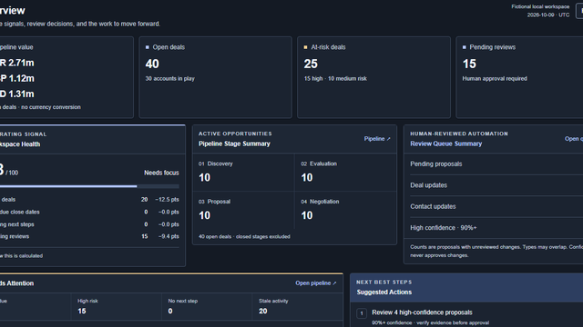
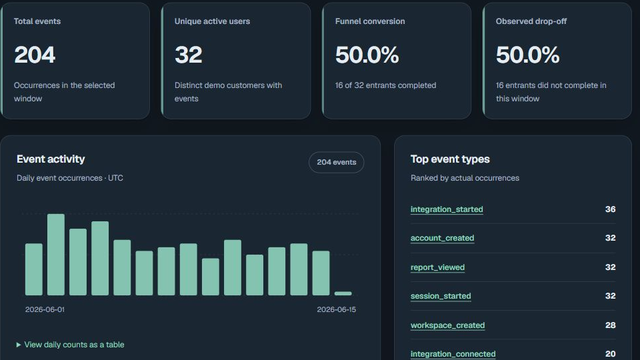
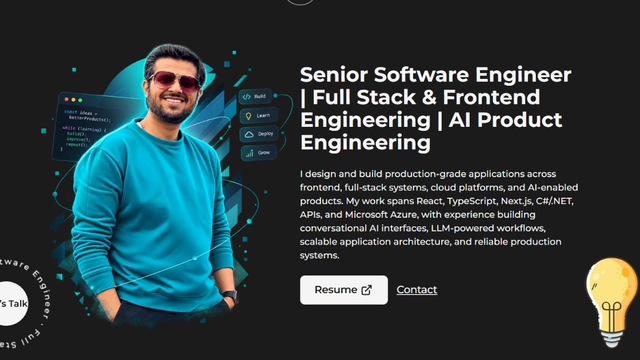
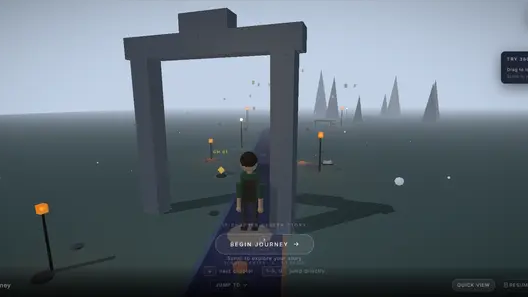
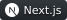
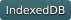

<picture>
  <source media="(prefers-reduced-motion: reduce) and (max-width: 600px)" srcset="assets/hero/engineering-os-mobile-static.svg">
  <source media="(prefers-reduced-motion: reduce)" srcset="assets/hero/engineering-os-static.svg">
  <source media="(max-width: 600px)" srcset="assets/hero/engineering-os-mobile.svg">
  
</picture>

<a href="https://www.saurabhbatra.com/">Website</a> · <a href="https://www.linkedin.com/in/saurabhbat">LinkedIn</a> · <a href="https://www.saurabhbatra.com/projects">Projects</a> · <a href="https://3dportfolio-sepia.vercel.app/">3D Portfolio</a>

I'm Saurabh, a **Software Engineer**.

**Full-Stack Systems · AI Applications · Cloud Engineering · Interactive Experiences**

I focus on making complex systems intuitive, reliable, and enjoyable to use.

## Featured projects

<table>
<tr>
<td width="50%" valign="top">
<b>DealPatch</b> 
Human-reviewed CRM with simulated AI. 
 
<a href="https://github.com/shubhbatra1991/dealpatch">GitHub</a> · <a href="https://dealpatch.vercel.app/">Live Demo</a>
</td>
<td width="50%" valign="top">
<b>SignalOps-AI</b> 
Customer signals and product insights. 
 
<a href="https://github.com/shubhbatra1991/signalops-ai">GitHub</a> · <a href="https://signalops-ai-nine.vercel.app/demo">Live Demo</a>
</td>
</tr>
</table>

## Portfolio & games

<table>
<tr>
<td width="50%" valign="top">
<a href="https://www.saurabhbatra.com/"><b>Personal website</b> </a> 
Engineering background and selected work.
</td>
<td width="50%" valign="top">
<a href="https://3dportfolio-sepia.vercel.app/"><b>3D portfolio</b> </a> 
An interactive engineering journey.
</td>
</tr>
</table>

**Project Oven · Unity** - Cozy bakery simulation in development. Gameplay preview pending approval.

<picture>
  <source media="(prefers-reduced-motion: reduce)" srcset="assets/decorations/static-divider.svg">
  
</picture>

## Technical Arsenal

<strong>Languages</strong> 

<strong>Frameworks & Runtimes</strong> 

<strong>Databases</strong> 

<strong>Cloud & DevOps</strong> 

<strong>AI & Data</strong> 

<strong>Creative Engineering</strong> 

<strong>Project implementation notes</strong>

**DealPatch:** local-first, fictional-data CRM with proposal diffs, selective approvals, audit and undo. AI analysis is simulated. Uses Dexie/IndexedDB for browser persistence. [Review Queue screenshot](assets/projects/dealpatch-review-queue.png).

**SignalOps-AI:** deterministic analytics, feedback, funnels and browser-local Product Missions. Optional self-hosted AI research supports OpenAI, Groq, Anthropic and Z.ai; provider requests are disabled in the public demo. Production ingestion, authentication and shared cloud workspaces are not implemented.

**Game media needed:** `assets/games/project-oven-gameplay.png`; optional `assets/games/project-oven-gameplay.gif`. Only approved captures of the Unity version will be used.

[More projects](https://www.saurabhbatra.com/projects) · [GitHub](https://github.com/shubhbatra1991)

<picture>
  <source media="(prefers-reduced-motion: reduce)" srcset="assets/decorations/static-divider.svg">
  
</picture>

## Contributions

<picture>
  <source media="(prefers-reduced-motion: reduce)" srcset="https://raw.githubusercontent.com/shubhbatra1991/shubhbatra1991/output/commit-defender-static.svg">
  
</picture>

[Native GitHub activity →](https://github.com/shubhbatra1991?tab=overview)
